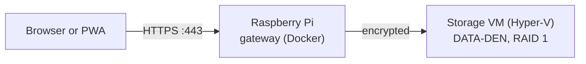

# DATA-DEN

A self-hosted NAS with a web interface to upload, download and manage files:
pictures, documents, videos and more. It installs as an app (PWA) on Android
and Windows.



- **Pi:** the only machine reachable from the internet. It terminates HTTPS
  and forwards to the storage VM, nothing else (rpi-setup task `dataden`).
- **Storage VM:** a Debian VM on the Windows PC with both disks passed
  through and mirrored. Windows itself does not see the disks, and only the
  Pi can reach the VM. Setup: [vm/README.md](vm/README.md).
- **DATA-DEN:** this repository, the web interface and its API, as one
  Docker image running in the VM: [deploy/README.md](deploy/README.md).

The server serves the website, `/api/health`, the login, the folder view,
downloads and uploads.

## Login

One account. Its password is stored only as a bcrypt hash:

```bash
cd backend && go run ./cmd/data-den hash-password       # or: docker run --rm -i data-den hash-password
```

Type the password and put the printed hash into the settings, for example a
`.env` next to the compose file (`.env.example` lists them). Put the hash in
single quotes there, `DATA_DEN_PASSWORD_HASH='$2a$12$...'`, or Docker
Compose reads its `$` signs as variables.

| Setting | Meaning |
|---|---|
| `DATA_DEN_USERNAME` | The account's name |
| `DATA_DEN_PASSWORD_HASH` | The hash from `hash-password`; without it nobody can log in |
| `DATA_DEN_TRUSTED_PROXY` | The Pi's address; only for requests from it is `X-Forwarded-For` the client's address |
| `DATA_DEN_DATA_DIR` | The data directory, default `/data`; in the storage VM the mirror at `/srv/data-den` |
| `LISTEN_ADDR` | Where the server listens, default `:8080` |
| `DATA_DEN_TLS_CERT`, `DATA_DEN_TLS_KEY` | Certificate and key in PEM files: with both the server speaks HTTPS, without them plain HTTP |

A login lasts 7 days, in an `HttpOnly`, `Secure`, `SameSite=Strict` cookie;
sessions live in memory, so a restart logs out. After 5 failed logins from
one address within 15 minutes, that address waits until the 15 minutes are
over. Each failed login is logged as `login failed ip=<address>` for
fail2ban on the Pi.

## Files

After the login the website has four tabs. **Dateien** shows the folders of
the data directory, with a path bar to go back up; a click on a photo, video,
song, PDF or text file opens it in the viewer, other files and the ⬇ link
download it. **Fotos** shows every photo as a gallery by month, **Videos**
every video, **Dokumente** every document with its folder; all newest first,
with a search over the path and 120 at a time. The viewer goes through the
list with ‹ › or the arrow keys, plays videos with seeking, shows PDFs in a
frame and text files up to 1 MB, and closes with Escape. Downloads can be
resumed (HTTP range requests), which matters for large videos. Every access
goes through Go's `os.Root`, so neither `..` nor a symlink reaches anything
outside the data directory; symlinks are not listed at all. In Docker the
server runs as user 65532, so the data directory has to belong to it:
`sudo chown -R 65532:65532 /srv/data-den`.

Photos, videos, music and documents get their own views. `/api/view` serves
a file for the browser to show, with range requests so a video can seek; it
only takes the formats listed in `backend/internal/files/view.go` (images,
MP4/WebM/MOV/MKV, common audio, PDF and plain text), never HTML, and serves
everything but PDFs in a CSP sandbox. Other files, such as Word or Excel
documents, are downloaded. `/api/media?kind=photo|video|audio|document` lists
every file of that kind in the whole data directory, newest first.

Uploads take many files or whole folders at once, picked with the two
buttons or dragged onto the page, into the open folder. Three files upload
at a time, each with its own progress bar. Every file goes in chunks of
8 MB (`/api/uploads`); a failed chunk is sent again from where the server
stands, so a broken connection costs at most one chunk. Folders in the path
are created, and an existing file is never overwritten: the upload stops
with "Datei existiert bereits". Unfinished chunks wait in
`.data-den-uploads/` in the data directory, which the folder view hides; a
restart of the server removes them.

## Development

Needs Go (version in `backend/go.mod`) and Node (version in
`frontend/.nvmrc`).

```bash
cd frontend && npm ci && npm run build   # builds the website into the backend
cd ../backend && DATA_DEN_USERNAME=me DATA_DEN_PASSWORD_HASH='<hash>' go run ./cmd/data-den   # http://localhost:8080
```

For live reload of the website, run `npm start` in `frontend/` next to the
backend: `http://localhost:4200`, with `/api` passed to the backend.

Checks, as CI runs them:

```bash
cd backend && gofmt -l . && golangci-lint run && go test ./...
cd frontend && npm run format:check && npm run lint && npm test && npm run build
```

With Docker:

```bash
docker build -t data-den .
docker run --rm -p 8080:8080 data-den
```

## CI

Every pull request runs the shared checks of
[repo-base](https://github.com/Programmer-Den/repo-base) (secrets, links,
PR template), the Go and Angular jobs, and builds the image for amd64 and
arm64. They run on the light self-hosted runners once those are set up
([runner/README.md](runner/README.md)), otherwise on GitHub's runners.

Contributions follow [AGENTS.md](AGENTS.md); security issues go to
[SECURITY.md](SECURITY.md).
