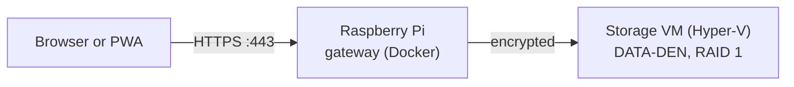

# DATA-DEN

A self-hosted NAS with a web interface to upload, download and manage files:
pictures, documents, videos and more. It installs as an app (PWA) on Android
and Windows.



- **Pi:** the only machine reachable from the internet. It terminates HTTPS
  and forwards to the storage VM, nothing else (rpi-setup task `dataden`).
- **Storage VM:** a Debian VM on the Windows PC with both disks passed
  through and mirrored. Windows itself does not see the disks, and only the
  Pi can reach the VM.
- **DATA-DEN:** this repository, the web interface and its API, as one
  Docker image running in the VM.

This is the skeleton: the server answers `/api/health` and serves the
website. Login, uploads and the file view follow.

## Development

Needs Go (version in `backend/go.mod`) and Node (version in
`frontend/.nvmrc`).

```bash
cd frontend && npm ci && npm run build   # builds the website into the backend
cd ../backend && go run ./cmd/data-den   # http://localhost:8080
```

For live reload of the website, run `npm start` in `frontend/` next to the
backend: `http://localhost:4200`, with `/api` passed to the backend.

Checks, as CI runs them:

```bash
cd backend && gofmt -l . && golangci-lint run && go test ./...
cd frontend && npm run format:check && npm run lint && npm test && npm run build
```

With Docker:

```bash
docker build -t data-den .
docker run --rm -p 8080:8080 data-den
```

## CI

Every pull request runs the shared checks of
[repo-base](https://github.com/Programmer-Den/repo-base) (secrets, links,
PR template), the Go and Angular jobs, and builds the image for amd64 and
arm64. They run on the light self-hosted runners once those are set up
([runner/README.md](runner/README.md)), otherwise on GitHub's runners.

Contributions follow [AGENTS.md](AGENTS.md); security issues go to
[SECURITY.md](SECURITY.md).
