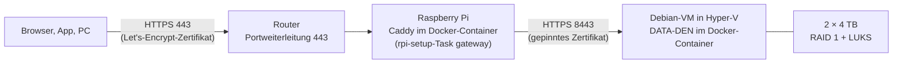

# DATA-DEN einrichten: Schritt für Schritt

Diese Anleitung führt durch die ganze Einrichtung, vom leeren Windows-PC bis
zum ersten Upload über das Internet. Sie fasst die englischen Anleitungen
zusammen, auf die sie verweist; dort steht jeweils das Kleingedruckte.

- [Wie alles zusammenhängt](#wie-alles-zusammenhängt)
- [Was du brauchst](#was-du-brauchst)
- [Reihenfolge auf einen Blick](#reihenfolge-auf-einen-blick)
- [Teil 1: Router und Adressen](#teil-1-router-und-adressen)
- [Teil 2: Windows-PC und Speicher-VM](#teil-2-windows-pc-und-speicher-vm)
- [Teil 3: DATA-DEN in der VM installieren](#teil-3-data-den-in-der-vm-installieren)
- [Teil 4: Raspberry Pi als Gateway](#teil-4-raspberry-pi-als-gateway)
- [Teil 5: Erster Aufruf und Besitzer-Konto](#teil-5-erster-aufruf-und-besitzer-konto)
- [Teil 6: Updates per Knopfdruck](#teil-6-updates-per-knopfdruck)
- [Teil 7: Optionale Funktionen](#teil-7-optionale-funktionen)
- [Checkliste für den ersten Test](#checkliste-für-den-ersten-test)
- [Fehlersuche](#fehlersuche)
- [Werte zum Notieren](#werte-zum-notieren)

## Wie alles zusammenhängt



- **Raspberry Pi:** der einzige Rechner, der aus dem Internet erreichbar ist.
  Ein Caddy-Container nimmt HTTPS auf Port 443 an (Zertifikat von Let's
  Encrypt) und reicht jede Anfrage verschlüsselt an die VM weiter. Er vertraut
  dabei nur genau dem Zertifikat der VM (Pinning).
- **Windows-PC:** stellt nur die Hardware. Beide 4-TB-Platten werden in
  Windows offline genommen und direkt an eine Hyper-V-VM durchgereicht;
  Windows selbst sieht die Daten nie.
- **Speicher-VM (Debian):** spiegelt die zwei Platten (RAID 1), verschlüsselt
  den Spiegel (LUKS, Schlüssel im virtuellen TPM) und führt DATA-DEN als
  Docker-Container aus. Zwei Firewalls (Hyper-V-Port-ACLs und nftables in der
  VM) lassen nur den Pi herein: Port 8443 (DATA-DEN), 9393 (Monitoring), 22
  (SSH) und Ping.
- **Verschlüsselt ist jeder Abschnitt:** Internet → Pi mit Let's Encrypt,
  Pi → VM mit dem selbst signierten, gepinnten Zertifikat der VM, die Platten
  mit LUKS. Wer will, legt besonders sensible Dateien zusätzlich in den
  Ende-zu-Ende-verschlüsselten **Tresor**.

## Was du brauchst

**Hardware und Netz**

- Windows-PC mit **Windows 10/11 Pro, Enterprise oder Education** (Home hat
  kein Hyper-V), Virtualisierung im BIOS/UEFI eingeschaltet, mindestens 8 GB
  RAM (die VM bekommt 4 GB, mit Office, Texterkennung oder Gesichtern 6 GB
  oder mehr).
- Zwei 4-TB-Festplatten im PC. **Sie werden komplett gelöscht.** Alles, was
  darauf liegt, vorher woanders hinkopieren.
- Raspberry Pi (64-Bit-Raspberry-Pi-OS) mit
  [rpi-setup](https://github.com/Programmer-Den/rpi-setup) und dem
  Deploy-Runner aus
  [rpi-deploy-and-update](https://github.com/Chriszly/rpi-deploy-and-update)
  (beim `pi5` schon vorhanden).
- Pi und PC per **Kabel** im selben Heimnetz.
- Ein Internetanschluss mit **eigener öffentlicher IPv4-Adresse**. Bei
  DS-Lite oder CGNAT (häufig bei Kabel- und Glasfaseranschlüssen) kommt eine
  Portweiterleitung nicht an; siehe [Fehlersuche](#fehlersuche).
- Ein Name für die öffentliche Adresse, z. B. der DynDNS-Name des Routers
  (bei ASUS: *WAN › DDNS*, etwa `meinname.asuscomm.com`) oder eine eigene
  Domain mit DynDNS.

**Software und Zugänge**

- Das Debian-**netinst**-ISO für amd64 (Debian 13), auf dem PC gespeichert,
  z. B. unter `C:\iso\`.
- Git für Windows auf dem PC (bringt auch `openssl` mit), OpenSSH-Client
  (in Windows 10/11 enthalten: `ssh`, `scp`).
- Ein SSH-Login auf den Pi vom PC aus.
- Ein GitHub-Token (classic) nur mit dem Recht **`read:packages`**: GitHub ›
  *Settings › Developer settings › Personal access tokens › Tokens
  (classic)*. Die VM lädt damit das private DATA-DEN-Image von ghcr.io.
- Ein **Passwort-Manager** (oder Papier) für die Schlüssel, die nur einmal
  angezeigt werden: Wiederherstellungsschlüssel der Platten, ggf.
  Backup-Passwort, 2FA-Codes, Tresor-Wiederherstellungsschlüssel.

**Zeit:** Die Einrichtung selbst dauert etwa 1 bis 2 Stunden. Der erste
Abgleich des Spiegels (4 TB) läuft danach noch mehrere Stunden im
Hintergrund; DATA-DEN ist währenddessen schon nutzbar.

## Reihenfolge auf einen Blick

1. Router: feste Adressen für Pi und VM, Port 443 zum Pi, DynDNS-Name.
2. Windows: Hyper-V, externer virtueller Switch, Platten finden.
3. VM anlegen (`New-DataDenVM.ps1`), Debian installieren.
4. In der VM: `install.sh` (Spiegel, Firewall, Updates, Docker, DATA-DEN).
5. Pi: Gateway-Werte in `pis/pi5/rpi-setup.env`, Task `gateway` ausführen.
6. Im Browser: `https://<dein Name>` öffnen, Besitzer-Konto anlegen.
7. Optional: Deploy-Runner auf dem PC, Passkeys, 2FA, App, WebDAV,
   Kalender, Monitoring, Backup.

## Teil 1: Router und Adressen

1. **Feste Adresse für den Pi:** im Router eine DHCP-Reservierung für den Pi
   (oder rpi-setup-Task `network`). Notiere sie, im Folgenden
   **PI-ADRESSE**, z. B. `192.168.1.20`.
2. **DynDNS-Name einrichten**, im Folgenden **DOMAIN**, z. B.
   `meinname.asuscomm.com`. Prüfen: `nslookup <DOMAIN>` zeigt deine
   öffentliche IPv4-Adresse.
3. **Portweiterleitung:** TCP **443** von außen auf PI-ADRESSE Port 443.
   Port 80 wird nicht gebraucht (das Zertifikat wird über 443 geholt).
4. Die feste Adresse der VM kommt in [Teil 2](#teil-2-windows-pc-und-speicher-vm),
   sobald die VM eine MAC-Adresse hat.

## Teil 2: Windows-PC und Speicher-VM

Ausführlich: [vm/README.md](../../vm/README.md) (englisch).

### 2.1 Hyper-V und Switch

1. *Windows-Features aktivieren oder deaktivieren* › **Hyper-V** anhaken,
   neu starten.
2. *Hyper-V-Manager › Manager für virtuelle Switches › Extern* › Switch
   anlegen, an die Netzwerkkarte binden, an der auch der Pi hängt. Name z. B.
   `External`.

### 2.2 Repository holen

In PowerShell auf dem PC:

```powershell
git clone https://github.com/Programmer-Den/DATA-DEN.git C:\DATA-DEN
cd C:\DATA-DEN
```

### 2.3 Platten finden

PowerShell **als Administrator**:

```powershell
Get-Disk | Format-Table Number, FriendlyName, SerialNumber, Size, IsBoot
```

Notiere die **Nummern** der beiden 4-TB-Platten (z. B. `1` und `2`). Die
Windows-Platte lehnt das Skript ab.

### 2.4 VM anlegen

```powershell
powershell -ExecutionPolicy Bypass -File vm\New-DataDenVM.ps1 `
    -DiskNumber 1,2 -IsoPath C:\iso\debian-13-amd64-netinst.iso `
    -SwitchName External -PiAddress 192.168.1.20
```

Das Skript zeigt beide Platten und fragt nach, bevor es sie in Windows
offline nimmt. Es legt eine VM der Generation 2 mit Secure Boot und
virtuellem TPM an, reicht die Platten durch und setzt gleich die
Port-ACLs: Ab jetzt kommt nur der Pi in die VM. Optionen: `-MemoryGB 6`,
`-ProcessorCount 4`, `-Name`, `-SystemDiskGB`.

### 2.5 Debian installieren

```powershell
Start-VM -Name DATA-DEN; vmconnect localhost DATA-DEN
```

- Nur auf die **32-GB-Systemplatte** installieren. Die beiden 4-TB-Platten
  nicht anfassen.
- Softwareauswahl: nur **SSH-Server** und **Standard-Systemwerkzeuge**, kein
  Desktop.
- Einen normalen Benutzer anlegen (im Folgenden **VM-BENUTZER**) und `sudo`
  einrichten: Root-Passwort leer lassen, dann bekommt der erste Benutzer
  `sudo`.
- Danach im Router eine **DHCP-Reservierung** für die MAC-Adresse der VM
  anlegen:

  ```powershell
  Get-VMNetworkAdapter -VMName DATA-DEN | Format-Table MacAddress, IPAddresses
  ```

  Die Adresse ist im Folgenden **VM-ADRESSE**, z. B. `192.168.1.30`. VM
  einmal neu starten, damit sie die reservierte Adresse bekommt.

Ab jetzt kommst du per SSH nur noch über den Pi in die VM (Sprung-Host):
`ssh -J <pi-benutzer>@<PI-ADRESSE> <VM-BENUTZER>@<VM-ADRESSE>`. Die
Konsole in `vmconnect` geht immer.

## Teil 3: DATA-DEN in der VM installieren

Ausführlich: [vm/README.md › Guided install](../../vm/README.md#4-guided-install)
und [deploy/README.md](../../deploy/README.md).

### 3.1 Skripte in die VM kopieren

Auf dem PC, im Ordner `C:\DATA-DEN`:

```powershell
scp -J <pi-benutzer>@192.168.1.20 -r vm deploy <VM-BENUTZER>@192.168.1.30:
```

### 3.2 Geführte Installation

In der VM (per SSH über den Pi oder in `vmconnect`):

```bash
sudo vm/install.sh --pi 192.168.1.20
```

Das Skript erledigt nacheinander neun Schritte und überspringt alles, was
schon erledigt ist. Bricht es ab, einfach erneut starten.

| Schritt | Was passiert | Was du tust |
|---|---|---|
| 1 Spiegel | Listet die freien Platten, baut RAID 1, verschlüsselt mit LUKS, hängt unter `/srv/data-den` ein | Nummern der beiden Platten eingeben, `DATA-DEN` tippen zum Löschen, **Wiederherstellungsschlüssel sicher notieren**, erste Gruppe zur Bestätigung eintippen |
| 2 Firewall | nftables: nur der Pi kommt herein | nichts |
| 3 Updates | Automatische Sicherheitsupdates, Neustart bei Bedarf um 05:00 | nichts |
| 4 Docker | `docker.io` aus Debian | nichts |
| 5 ghcr.io | Login für das private Image | GitHub-Benutzername (`Chriszly`) und das `read:packages`-Token als Passwort |
| 6 Ordner | `~/data-den` mit `compose.yaml` und `.env` (`DATA_DEN_TRUSTED_PROXY` = Pi) | nichts |
| 7 Zertifikat | Selbst signiertes Zertifikat für den Weg Pi → VM (10 Jahre) | nichts |
| 8 Start | Startet DATA-DEN und wartet, bis es auf 8443 antwortet | nichts |
| 9 Deploys | Erlaubt Updates von Windows aus (ohne Netzwerkzugang in die VM) | nichts |

Am Ende druckt das Skript die Zeilen für den Pi und den **Einrichtungscode**:

```text
GATEWAY_UPSTREAM=192.168.1.30
GATEWAY_UPSTREAM_PORT=8443
GATEWAY_UPSTREAM_NAME=data-den
GATEWAY_UPSTREAM_FINGERPRINT=AB:CD:...
GATEWAY_DOMAIN=<the Pi's public name, such as nas.example.org>
```

Beide notieren. Später nochmal anzeigen:
`vm/install.sh --pi-settings ~/data-den` und
`sudo cat /srv/data-den/.data-den-accounts/setup-code`.

### 3.3 Adresse für Passkeys eintragen

Damit Passkeys funktionieren, muss DATA-DEN die öffentliche Adresse kennen:

```bash
cd ~/data-den
echo 'DATA_DEN_ORIGIN=https://<DOMAIN>' >> .env
sudo docker compose up -d
```

### 3.4 Kurz prüfen

```bash
cat /proc/mdstat                        # active raid1 ... [UU] (oder resync läuft)
df -h /srv/data-den                     # etwa 3,6 TB
sudo vm/disk-key.sh status              # offen, Schlüssel tpm2 und recovery
cd ~/data-den && sudo docker compose ps # data-den: healthy
curl -k https://localhost:8443/api/health
```

## Teil 4: Raspberry Pi als Gateway

Ausführlich: [rpi-setup › gateway](https://github.com/Programmer-Den/rpi-setup/blob/main/docs/tasks/gateway.md)
und [rpi-deploy-and-update › DATA-DEN](https://github.com/Chriszly/rpi-deploy-and-update#data-den).

### 4.1 Einstellungen eintragen

In **rpi-deploy-and-update**, Datei `pis/pi5/rpi-setup.env`, Abschnitt
`gateway` (im Browser auf GitHub oder lokal):

```bash
GATEWAY_DOMAIN=<DOMAIN>
GATEWAY_UPSTREAM=192.168.1.30
GATEWAY_UPSTREAM_PORT=8443          # steht schon da
GATEWAY_UPSTREAM_NAME=data-den      # steht schon da
GATEWAY_UPSTREAM_FINGERPRINT=AB:CD:...
GATEWAY_EMAIL=                      # optional, für Ablaufwarnungen von Let's Encrypt
```

Der Fingerabdruck ist öffentlich und darf ins Repository. In
`pis/pi5/tasks` die Zeile `# gateway` zu `gateway` ändern, damit **Update
Pi** das Gateway künftig mitpflegt. Committen auf `main`.

### 4.2 Gateway einrichten

Auf GitHub in rpi-deploy-and-update: **Actions › Deploy to Pi › Run
workflow** mit

- **pi:** `pi5`
- **tasks:** `gateway`
- **settings:** angehakt

Der Lauf installiert die Einstellungen, startet den Caddy-Container
`gateway` in `/opt/gateway`, gibt Port 443 von Pi-hole frei (dessen
Admin-Seite bleibt auf HTTP) und fragt am Ende DATA-DEN über das gepinnte
Zertifikat an.

Alternativ direkt auf dem Pi, im rpi-setup-Ordner:
`sudo bash setup.sh gateway`.

Ist der Windows-Runner schon eingerichtet ([Teil 6](#teil-6-updates-per-knopfdruck)),
erledigt **Deploy DATA-DEN** mit angehaktem **gateway** beides auf einmal.

### 4.3 Prüfen

Auf dem Pi:

```bash
docker logs gateway            # "certificate obtained successfully" für DOMAIN
sudo bash check.sh             # im rpi-setup-Ordner: Container, Port 443, App antwortet
curl -sk --resolve data-den:8443:192.168.1.30 https://data-den:8443/api/health
```

## Teil 5: Erster Aufruf und Besitzer-Konto

1. `https://<DOMAIN>` öffnen, am besten **vom Handy im Mobilfunknetz**
   (WLAN aus). Aus dem Heimnetz klappt der Name nur, wenn der Router
   NAT-Loopback kann.
2. Die Seite **Einrichtung** erscheint:
   - **Einrichtungscode** aus Schritt 3.2 eingeben.
   - **Prüfungen** ansehen: Datenordner beschreibbar, freier Platz, RAID,
     HTTPS zwischen Pi und VM, Adresse des Pi, HTTPS im Browser. Nur ein
     nicht beschreibbarer Datenordner hält die Einrichtung auf; alle anderen
     Warnungen erklären, was zu tun ist.
   - **Besitzer-Konto:** Name (a-z, 0-9, `.`, `-`, `_`) und Passwort (mind.
     10 Zeichen).
3. Anmelden. Fertig: Hochladen, Ordner anlegen, herunterladen.
4. Als App installieren: im Browser-Menü **App installieren** bzw. **Zum
   Startbildschirm hinzufügen** (PWA, Android und Windows).

## Teil 6: Updates per Knopfdruck

Neue Versionen kommen, ohne dass jemand per SSH in die VM muss: Ein
GitHub-Runner auf dem PC übergibt die Version über Hyper-Vs
Key-Value-Austausch an die VM, die VM zieht das Image, startet neu und geht
zurück zur alten Version, wenn die neue nicht gesund wird.

Einmalig auf dem PC, PowerShell **als Administrator**:

1. In rpi-deploy-and-update: *Settings › Actions › Runners › New
   self-hosted runner*, den Wert hinter `--token` kopieren (1 Stunde
   gültig).
2. In einem Checkout von rpi-deploy-and-update:

   ```powershell
   powershell -ExecutionPolicy Bypass -File windows-runner\Install-DeployRunner.ps1
   ```

   Fragt nach dem Token, legt das Konto `deploy-runner` (kein Admin) an und
   startet den Runner als Dienst.
3. Im DATA-DEN-Checkout:

   ```powershell
   powershell -ExecutionPolicy Bypass -File vm\Deploy-DataDen.ps1 -Install -RunnerAccount deploy-runner
   powershell -ExecutionPolicy Bypass -File vm\Watch-DataDenDisks.ps1 -Install
   ```

   Das Zweite prüft alle 15 Minuten die SMART-Werte der Platten und meldet
   sie an die VM. In der VM dazu einmal `sudo vm/setup-disk-health.sh on`.

Danach: rpi-deploy-and-update › **Actions › Deploy DATA-DEN › Run
workflow**, **tag** `latest` (neuestes Release), eine Version wie `0.1.0`
oder `main` (neuester Stand). Das Log zeigt die Antwort der VM.

Von Hand geht es auch: auf dem PC
`vm\Deploy-DataDen.ps1 -Tag main` oder in der VM
`cd ~/data-den && sudo docker compose pull && sudo docker compose up -d`.

## Teil 7: Optionale Funktionen

Alle Einstellungen der VM stehen in `~/data-den/.env`; nach jeder Änderung
`cd ~/data-den && sudo docker compose up -d`. Die vollständige Liste steht in
der [README](../../README.md#owner-in-the-settings).

### Sicherer anmelden: Passkeys und Zwei-Faktor

- **Passkeys** (Fingerabdruck, Gesicht, PIN): brauchen
  `DATA_DEN_ORIGIN=https://<DOMAIN>` (Schritt 3.3). Im Tab **Konto** einen
  Passkey hinzufügen; danach zeigt die Anmeldung **Mit Passkey anmelden**.
  Funktioniert nur unter DOMAIN, nicht unter der Adresse der VM.
- **Zwei-Faktor (TOTP):** Tab **Konto**, QR-Code mit einer
  Authenticator-App scannen, Code eingeben, die **zehn
  Wiederherstellungscodes** sicher ablegen.

### App-Passwörter

Für die Android-App, Netzlaufwerke, Kalender und den Sync-Client: Tab
**Konto › App-Passwörter**. Das Token (`dd_…`) wird nur einmal angezeigt; für
Uploads nicht „nur lesen" wählen.

### Netzlaufwerk (WebDAV)

SMB gibt es bewusst nicht (es müsste die VM fürs Netz öffnen). Stattdessen
WebDAV über dieselbe HTTPS-Adresse:

- **Windows-Explorer:** *Dieser PC › Netzlaufwerk verbinden*, Ordner
  `https://<DOMAIN>/dav/`, **Verbindung mit anderen Anmeldeinformationen
  herstellen**, Benutzername und App-Passwort. Für Dateien über 50 MB in der
  Registry `HKLM\SYSTEM\CurrentControlSet\Services\WebClient\Parameters` den
  Wert `FileSizeLimitInBytes` auf `0xFFFFFFFF` setzen und den Dienst
  *WebClient* neu starten.
- **Linux:** `davs://<DOMAIN>/dav/`, **macOS:** Finder › *Mit Server
  verbinden*, `https://<DOMAIN>/dav/`.

### Kalender und Kontakte (CalDAV, CardDAV)

- **Android:** App *DAVx⁵* › *Mit URL und Benutzername anmelden*, URL
  `https://<DOMAIN>`, Benutzername und App-Passwort.
- **iPhone/Mac:** *Andere › CalDAV-Account* bzw. *CardDAV-Account*, Server
  `<DOMAIN>`.
- **Thunderbird:** *Neuer Kalender › Im Netzwerk*, `https://<DOMAIN>`.

### Android-App (automatischer Foto-Upload)

1. APK aus dem neuesten
   [Release](https://github.com/Programmer-Den/DATA-DEN/releases) laden
   (`data-den-android-<version>.apk`) und installieren (Installation aus
   unbekannten Quellen erlauben).
2. App öffnen: Adresse `<DOMAIN>`, App-Passwort (schreibend), Zielordner,
   z. B. `/Fotos/Handy`.
3. Zugriff auf Fotos und Videos, Benachrichtigungen und **Standort in
   Fotos** erlauben (sonst entfernt Android die Ortsdaten).

Standardmäßig lädt sie nur im WLAN hoch. **Tresor öffnen** öffnet den Tresor
(siehe unten). Details: [android/README.md](../../android/README.md).

### Sync-Client für Windows

`data-den-sync-windows-amd64.exe` aus dem Release (oder angemeldet unter
`https://<DOMAIN>/api/sync/client/data-den-sync-windows-amd64.exe`):

```powershell
.\data-den-sync.exe setup           # Adresse, App-Passwort, Ordner auf dem PC und in DATA-DEN
.\data-den-sync.exe run             # synchronisiert jetzt und jede Minute
.\data-den-sync.exe autostart on    # bei jeder Anmeldung
```

### Tresor (Ende-zu-Ende-verschlüsselt)

Tab **Tresor**: Passphrase (mind. 12 Zeichen) wählen und den
**Wiederherstellungsschlüssel** sicher ablegen. **Ohne Passphrase und
Wiederherstellungsschlüssel sind die Dateien verloren**, auch für Admins.
Keine Suche, Vorschau, Freigaben oder Papierkorb im Tresor; max. 1 GB pro
Datei.

### E-Mail- und Push-Benachrichtigungen

In `.env`, z. B. für GMX:

```bash
DATA_DEN_SMTP_HOST=smtp.gmx.net
DATA_DEN_SMTP_PORT=587
DATA_DEN_SMTP_USERNAME=<adresse>
DATA_DEN_SMTP_PASSWORD='<app-passwort des mail-anbieters>'
DATA_DEN_SMTP_FROM='DATA-DEN <adresse>'
```

Dann im Tab **Benachrichtigungen** wählen, was per Mail oder Push kommt, und
**Testnachricht senden**. Push braucht keine weitere Einstellung, nur
**Auf diesem Gerät einschalten**.

### Monitoring mit den-watcher

1. In `.env` der VM einen Kopplungscode setzen (8 Zeichen aus Ziffern und
   Großbuchstaben ohne 0, 1, I, O):

   ```bash
   DATA_DEN_MONITOR_ADDR=:9393
   DATA_DEN_MONITOR_CODE=7KQM-X2RP
   ```

2. `sudo docker compose up -d`.
3. In den-watcher auf dem Pi (`http://<PI-ADRESSE>:8090`) im Dialog
   **Devices** `<VM-ADRESSE>:9393` als Server mit dem Code hinzufügen.

Der Hub zeigt dann CPU, Speicher, freien Platz, RAID, Plattenzustand,
Backup und letzten Deploy; ein fehlendes RAID-Mitglied und eine schlechte
Platte lösen einen Alarm aus.

### Office, Texterkennung, Gesichter

Zusätzliche Container in der VM, jeweils mit eigener Compose-Datei aus
`deploy/` (Details in [deploy/README.md](../../deploy/README.md)):

| Funktion | Datei | Einstellung in `.env` | RAM zusätzlich |
|---|---|---|---|
| Office im Browser (Collabora) | `compose.office.yaml` | `DATA_DEN_OFFICE_URL=http://127.0.0.1:9980` | ca. 1 GB |
| Texterkennung (Tika, Tesseract) | `compose.ocr.yaml` + `tika-config.json` | `DATA_DEN_OCR_URL=http://127.0.0.1:9998` | bis 2 GB |
| Personen und Dinge (Immich ML) | `compose.vision.yaml` | `DATA_DEN_VISION=http://127.0.0.1:3003` | ca. 2 GB |

Starten mit allen genutzten Dateien, z. B.
`sudo docker compose -f compose.yaml -f compose.office.yaml up -d`. Für den
ersten Test weglassen; die VM braucht dafür mehr RAM (`Set-VMMemory`).

### Backup

RAID 1 ist kein Backup. Nächtliche, verschlüsselte, versionierte Sicherung
mit restic auf eine externe Platte oder auswärts:
`sudo vm/setup-backup.sh on <ziel>`. Das Passwort, das dabei einmal
angezeigt wird, **außerhalb der VM sichern**. Anleitung:
[vm/README.md › Backup](../../vm/README.md#backup-optional).

## Checkliste für den ersten Test

Haken für Haken; was nicht klappt, steht unter [Fehlersuche](#fehlersuche).

**Isolation**

- [ ] Windows-Explorer zeigt die 4-TB-Platten nicht mehr,
      Datenträgerverwaltung zeigt sie *Offline*.
- [ ] Vom PC aus: `ping <VM-ADRESSE>` und `ssh <VM-ADRESSE>` laufen ins
      Leere; `curl.exe -k https://<VM-ADRESSE>:8443` ebenso.
- [ ] Vom Pi aus: `ssh <VM-BENUTZER>@<VM-ADRESSE>` klappt.
- [ ] In der VM: `sudo nft list ruleset` zeigt PI-ADRESSE.

**Speicher**

- [ ] `cat /proc/mdstat`: `active raid1`, `[UU]` (oder Resync mit
      Fortschritt).
- [ ] `sudo vm/disk-key.sh status`: offen, `tpm2` und `recovery`.
- [ ] `sudo reboot` der VM: danach ist `/srv/data-den` von selbst wieder
      eingehängt und DATA-DEN `healthy`.
- [ ] Wiederherstellungsschlüssel liegt im Passwort-Manager.

**Zugang von außen**

- [ ] `https://<DOMAIN>` vom Handy im Mobilfunknetz: gültiges
      Schloss-Symbol, Anmeldeseite.
- [ ] Einrichtung abgeschlossen, Status-Tab zeigt RAID und freien Platz
      ohne Warnung.

**Funktionen**

- [ ] Ordner anlegen, mehrere Fotos und ein großes Video (> 1 GB) hochladen.
- [ ] Upload unterbrechen (WLAN kurz aus): er setzt fort.
- [ ] Herunterladen, Video im Viewer abspielen und spulen.
- [ ] Datei löschen, aus dem **Papierkorb** wiederherstellen.
- [ ] Freigabelink mit Passwort erstellen und in einem privaten Fenster
      öffnen.
- [ ] Zweites Konto im Tab **Benutzer** anlegen; es sieht die Dateien des
      Besitzers nicht.
- [ ] Fünfmal falsches Passwort: Sperre für 15 Minuten
      (`login failed ip=<deine öffentliche Adresse>` im Log, nicht die des
      Pi).
- [ ] Passkey anlegen und damit anmelden.
- [ ] App-Passwort anlegen, Netzlaufwerk in Windows verbinden.
- [ ] Android-App: Foto aufnehmen, es erscheint im Zielordner.
- [ ] **Deploy DATA-DEN** mit `latest` läuft grün durch.

**Ausfall (optional, wenn Zeit ist)**

- [ ] VM aus, eine Platte in Hyper-V abziehen, VM an: DATA-DEN läuft weiter,
      Status-Tab warnt, `/proc/mdstat` zeigt `[U_]`. Platte wieder
      anhängen und mit
      `sudo mdadm --manage /dev/md/data-den --add /dev/disk/by-id/<platte>`
      zurück in den Spiegel nehmen.

## Fehlersuche

| Symptom | Ursache und Abhilfe |
|---|---|
| `New-DataDenVM.ps1`: Hyper-V-Befehle fehlen | Hyper-V nicht aktiviert oder Windows Home. PowerShell als Administrator starten. |
| Debian startet nicht von der ISO (Secure Boot) | Das Skript setzt die Vorlage *Microsoft UEFI Certificate Authority*. Prüfen: `Get-VMFirmware DATA-DEN`. |
| `install.sh`: „Found 0/1 free disks" | Platten nicht durchgereicht: `Get-VMHardDiskDrive -VMName DATA-DEN` muss beide zeigen. |
| `install.sh` Schritt 5: `denied`/`unauthorized` | Token falsch, abgelaufen oder ohne `read:packages`. Neues Token, `sudo docker login ghcr.io -u Chriszly`. |
| `install.sh` Schritt 8: DATA-DEN antwortet nicht | `cd ~/data-den && sudo docker compose logs`. Oft: `/srv/data-den` nicht eingehängt (`sudo vm/disk-key.sh unlock`). |
| Spiegel nach Neustart gesperrt, DATA-DEN zeigt leere Platte | TPM wurde zurückgesetzt (neue VM, Secure Boot aus). `sudo vm/disk-key.sh unlock` mit dem Wiederherstellungsschlüssel, dann `sudo vm/disk-key.sh tpm`. |
| VM hat kein Internet (apt, docker pull) | DHCP-Reservierung und Switch prüfen; ausgehend ist alles erlaubt. `ip -4 route` in der VM muss eine Default-Route zeigen. |
| SSH vom Pi in die VM geht nicht | Falsche PI-ADRESSE in ACLs oder nftables: `vm\Set-DataDenNetwork.ps1 -PiAddress <neu>` auf dem PC, `sudo vm/setup-firewall.sh <neu>` in der VM (über `vmconnect`). |
| `docker logs gateway`: Zertifikat wird nicht ausgestellt | DOMAIN zeigt nicht auf die öffentliche Adresse, 443 nicht weitergeleitet, oder **DS-Lite/CGNAT** (WAN-Adresse im Router beginnt mit `100.64.`–`100.127.`, `10.` oder es gibt nur IPv6). Beim Anbieter eine öffentliche IPv4 bzw. „Dual-Stack" anfragen. |
| Gateway-Task stoppt: Port 443 belegt | Anderes Programm auf 443 (`sudo ss -tlnp 'sport = :443'`). Pi-hole gibt der Task selbst frei. |
| Browser zeigt `502 Bad Gateway` | Pi erreicht die VM nicht oder das Zertifikat passt nicht zum Fingerabdruck. Vom Pi: `curl -sk https://<VM-ADRESSE>:8443/api/health`; Fingerabdruck mit `vm/install.sh --pi-settings ~/data-den` vergleichen und den Task neu laufen lassen. |
| `https://<DOMAIN>` geht von außen, nicht aus dem WLAN | Router kann kein NAT-Loopback. Im Pi-hole einen lokalen DNS-Eintrag DOMAIN → PI-ADRESSE anlegen. |
| Einrichtung: Warnung „Adresse des Pi" | `DATA_DEN_TRUSTED_PROXY` in `~/data-den/.env` muss PI-ADRESSE sein. |
| Passkey-Button fehlt oder Fehler | `DATA_DEN_ORIGIN` fehlt oder passt nicht genau (`https://`, kein `/` am Ende, genau DOMAIN). Nur unter DOMAIN aufrufen. |
| Einrichtungscode verloren | `sudo cat /srv/data-den/.data-den-accounts/setup-code`; nach zehn Fehlversuchen gibt es einen neuen. |
| Upload bricht bei großen Dateien ab | `cd ~/data-den && sudo docker compose logs -f` und `docker logs gateway`; freien Platz prüfen. |
| **Deploy DATA-DEN** bleibt in der Warteschlange | Windows-Runner offline (Dienst auf dem PC) oder PC aus. |
| **Deploy DATA-DEN**: `status=failed` | Die VM ist zur vorherigen Version zurück. In der VM: `journalctl -u data-den-deploy`. |
| Netzlaufwerk in Windows: „Ordner ungültig" | Dienst *WebClient* läuft nicht, oder Konto-Passwort statt App-Passwort benutzt. |

Logs auf einen Blick:

- VM: `cd ~/data-den && sudo docker compose logs -f`
- Pi: `docker logs -f gateway`
- Deploys: `journalctl -u data-den-deploy` (VM), Actions-Log auf GitHub

## Werte zum Notieren

| Wert | Beispiel | Wo gebraucht |
|---|---|---|
| PI-ADRESSE | `192.168.1.20` | `New-DataDenVM.ps1`, `install.sh`, ACLs |
| VM-ADRESSE | `192.168.1.30` | `GATEWAY_UPSTREAM`, den-watcher |
| DOMAIN | `meinname.asuscomm.com` | Router, `GATEWAY_DOMAIN`, `DATA_DEN_ORIGIN`, Apps |
| Fingerabdruck | `AB:CD:…` | `GATEWAY_UPSTREAM_FINGERPRINT` |
| Platten-Wiederherstellungsschlüssel | 8 Gruppen | Passwort-Manager, **nie verlieren** |
| Einrichtungscode | | Einmalig im Browser |
| Kopplungscode Monitoring | `7KQM-X2RP` | `.env`, den-watcher |
| Backup-Passwort (restic) | | Passwort-Manager, **nie verlieren** |
