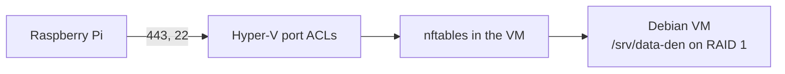

# Storage VM

The data lives in a Debian VM under Hyper-V on the Windows PC. Both 4 TB
disks are passed through to it and mirrored (RAID 1), so Windows, its Docker
and the runner containers never see them. Only the Pi gets into the VM.



Two walls keep everything else out: the port ACLs of the VM's network
adapter (`Set-DataDenNetwork.ps1`) and nftables in the VM
(`setup-firewall.sh`). The Windows Firewall does not filter a VM on an
external switch, so it plays no part. RAID 1 protects against one failing
disk; it is not a backup.

| File | Runs on | Does |
|---|---|---|
| `New-DataDenVM.ps1` | Windows, as administrator | Creates the VM, takes both disks offline in Windows and passes them through |
| `Set-DataDenNetwork.ps1` | Windows, as administrator | Port ACLs: only the Pi gets in (HTTPS, SSH, ping), the VM may connect out |
| `setup-raid.sh` | the VM, as root | RAID 1 over both disks with mdadm, mounted at `/srv/data-den` |
| `setup-firewall.sh`, `nftables.conf` | the VM, as root | nftables: only the Pi gets in |
| `test-vm-scripts.sh` | CI | Tests the checks of the shell scripts |

## Before you start

- Windows Pro with Hyper-V (**Turn Windows features on or off › Hyper-V**)
- An external virtual switch (**Hyper-V Manager › Virtual Switch Manager ›
  External**), bound to the network card the Pi is on
- The Debian netinst ISO for amd64
- The Pi's address in the home network; give it a fixed one in the router
- **Both disks will be erased.** Copy anything on them elsewhere first.

## 1. Find the disks

In PowerShell as administrator:

```powershell
Get-Disk | Format-Table Number, FriendlyName, SerialNumber, Size, IsBoot
```

Note the two numbers of the 4 TB disks. The script refuses the Windows disk.

## 2. Create the VM

```powershell
powershell -ExecutionPolicy Bypass -File vm\New-DataDenVM.ps1 `
    -DiskNumber 1,2 -IsoPath C:\iso\debian-13-amd64-netinst.iso `
    -SwitchName External -PiAddress 192.168.1.20
```

It shows both disks and asks before it takes them offline in Windows.
Options: `-Name` (default `DATA-DEN`), `-MemoryGB` (4), `-ProcessorCount`
(2), `-SystemDiskGB` (32). The VM gets no checkpoints, as passed-through
disks cannot be in one, and starts and stops with Windows.

## 3. Install Debian

```powershell
Start-VM -Name DATA-DEN; vmconnect localhost DATA-DEN
```

- Install onto the 32 GB system disk only. Leave both 4 TB disks untouched.
- Software selection: only **SSH server** and **standard system
  utilities**, no desktop.
- After the installation, give the VM a fixed address: a DHCP reservation in
  the router for the MAC address that `Get-VMNetworkAdapter -VMName DATA-DEN`
  shows.

Until the next step, SSH works only from the Pi:
`ssh -J <user>@<pi> <user>@<vm>`. The console in `vmconnect` always works.

## 4. RAID 1 and firewall in the VM

Copy this folder into the VM (`scp -J <user>@<pi> -r vm <user>@<vm>:`), then
in the VM:

```bash
ls -l /dev/disk/by-id/ | grep -v part        # the two 4 TB disks
sudo vm/setup-raid.sh /dev/disk/by-id/<disk 1> /dev/disk/by-id/<disk 2>
sudo vm/setup-firewall.sh 192.168.1.20       # the Pi's address
```

`setup-raid.sh` shows both disks and asks you to type `DATA-DEN` before it
erases them. The first resync of 4 TB takes several hours; the mirror can be
used meanwhile. Check it with `cat /proc/mdstat`.

## Check that it worked

- Windows no longer lists the disks in Explorer, and **Disk Management**
  shows them *Offline*.
- In the VM: `cat /proc/mdstat` shows an `active raid1` array with `[UU]`,
  and `df -h /srv/data-den` about 3.6 TB.
- From the Pi, `ssh <user>@<vm>` works. From the Windows PC or another
  device, `ssh <user>@<vm>` and `ping <vm>` time out.
- `sudo nft list ruleset` in the VM shows the Pi's address.

## When the Pi's address changes

```powershell
powershell -ExecutionPolicy Bypass -File vm\Set-DataDenNetwork.ps1 -PiAddress <new>
```

and in the VM `sudo vm/setup-firewall.sh <new>`.

## When a disk fails

`cat /proc/mdstat` shows `[U_]`, and mdadm mails root. The data stays
readable from the other disk. Shut the VM down, replace the disk, pass the
new one through (`Set-Disk -Number <n> -IsOffline $true`, then
`Add-VMHardDiskDrive -VMName DATA-DEN -ControllerType SCSI -DiskNumber <n>`)
and add it to the mirror in the VM:

```bash
sudo mdadm --manage /dev/md/data-den --add /dev/disk/by-id/<new disk>
```

Den-Watcher will report the RAID state as an alarm in a later step.
