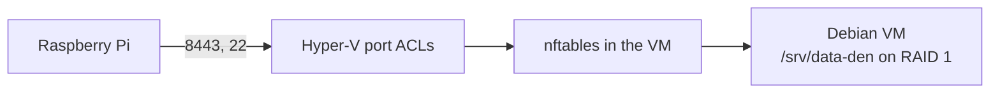

# Storage VM

The data lives in a Debian VM under Hyper-V on the Windows PC. Both 4 TB
disks are passed through to it and mirrored (RAID 1), so Windows, its Docker
and the runner containers never see them. Only the Pi gets into the VM.



Two walls keep everything else out: the port ACLs of the VM's network
adapter (`Set-DataDenNetwork.ps1`) and nftables in the VM
(`setup-firewall.sh`). The Windows Firewall does not filter a VM on an
external switch, so it plays no part. RAID 1 protects against one failing
disk; it is not a backup. Against deleting, ransomware or a fire there is an
optional backup: [Backup (optional)](#backup-optional).

| File | Runs on | Does |
|---|---|---|
| `New-DataDenVM.ps1` | Windows, as administrator | Creates the VM, takes both disks offline in Windows and passes them through |
| `Set-DataDenNetwork.ps1` | Windows, as administrator | Port ACLs: only the Pi gets in (HTTPS, SSH, ping), the VM may connect out |
| `setup-raid.sh` | the VM, as root | RAID 1 over both disks with mdadm, mounted at `/srv/data-den` |
| `setup-firewall.sh`, `nftables.conf` | the VM, as root | nftables: only the Pi gets in |
| `setup-updates.sh` | the VM, as root | Switches automatic security updates on or off, or shows their status |
| `setup-backup.sh` | the VM, as root | Switches the optional backup on or off, or shows its status |
| `backup.sh`, `data-den-backup.service`, `data-den-backup.timer` | the VM, installed by `setup-backup.sh` | The nightly backup run with restic |
| `backup-result.sh`, `event.sh` | the VM, installed by `setup-backup.sh` | Hand a failed backup run to DATA-DEN, which notifies the admins |
| `test-vm-scripts.sh` | CI | Tests the checks of the shell scripts |

## Before you start

- Windows Pro with Hyper-V (**Turn Windows features on or off › Hyper-V**)
- An external virtual switch (**Hyper-V Manager › Virtual Switch Manager ›
  External**), bound to the network card the Pi is on
- The Debian netinst ISO for amd64
- The Pi's address in the home network; give it a fixed one in the router
- **Both disks will be erased.** Copy anything on them elsewhere first.

## 1. Find the disks

In PowerShell as administrator:

```powershell
Get-Disk | Format-Table Number, FriendlyName, SerialNumber, Size, IsBoot
```

Note the two numbers of the 4 TB disks. The script refuses the Windows disk.

## 2. Create the VM

```powershell
powershell -ExecutionPolicy Bypass -File vm\New-DataDenVM.ps1 `
    -DiskNumber 1,2 -IsoPath C:\iso\debian-13-amd64-netinst.iso `
    -SwitchName External -PiAddress 192.168.1.20
```

It shows both disks and asks before it takes them offline in Windows.
Options: `-Name` (default `DATA-DEN`), `-MemoryGB` (4), `-ProcessorCount`
(2), `-SystemDiskGB` (32). The VM gets no checkpoints, as passed-through
disks cannot be in one, and starts and stops with Windows.

## 3. Install Debian

```powershell
Start-VM -Name DATA-DEN; vmconnect localhost DATA-DEN
```

- Install onto the 32 GB system disk only. Leave both 4 TB disks untouched.
- Software selection: only **SSH server** and **standard system
  utilities**, no desktop.
- After the installation, give the VM a fixed address: a DHCP reservation in
  the router for the MAC address that `Get-VMNetworkAdapter -VMName DATA-DEN`
  shows.

Until the next step, SSH works only from the Pi:
`ssh -J <user>@<pi> <user>@<vm>`. The console in `vmconnect` always works.

## 4. RAID 1 and firewall in the VM

Copy this folder into the VM (`scp -J <user>@<pi> -r vm <user>@<vm>:`), then
in the VM:

```bash
ls -l /dev/disk/by-id/ | grep -v part        # the two 4 TB disks
sudo vm/setup-raid.sh /dev/disk/by-id/<disk 1> /dev/disk/by-id/<disk 2>
sudo vm/setup-firewall.sh 192.168.1.20       # the Pi's address
sudo vm/setup-updates.sh on                  # automatic security updates
```

`setup-raid.sh` shows both disks and asks you to type `DATA-DEN` before it
erases them. The first resync of 4 TB takes several hours; the mirror can be
used meanwhile. Check it with `cat /proc/mdstat`.

Then start DATA-DEN in the VM: [deploy/README.md](../deploy/README.md).

## Check that it worked

- Windows no longer lists the disks in Explorer, and **Disk Management**
  shows them *Offline*.
- In the VM: `cat /proc/mdstat` shows an `active raid1` array with `[UU]`,
  and `df -h /srv/data-den` about 3.6 TB.
- From the Pi, `ssh <user>@<vm>` works. From the Windows PC or another
  device, `ssh <user>@<vm>` and `ping <vm>` time out.
- `sudo nft list ruleset` in the VM shows the Pi's address.

## When the Pi's address changes

```powershell
powershell -ExecutionPolicy Bypass -File vm\Set-DataDenNetwork.ps1 -PiAddress <new>
```

and in the VM `sudo vm/setup-firewall.sh <new>`.

## When a disk fails

`cat /proc/mdstat` shows `[U_]`, and mdadm mails root. The data stays
readable from the other disk. Shut the VM down, replace the disk, pass the
new one through (`Set-Disk -Number <n> -IsOffline $true`, then
`Add-VMHardDiskDrive -VMName DATA-DEN -ControllerType SCSI -DiskNumber <n>`)
and add it to the mirror in the VM:

```bash
sudo mdadm --manage /dev/md/data-den --add /dev/disk/by-id/<new disk>
```

Den-Watcher will report the RAID state as an alarm in a later step.

## Automatic updates

Switch them on once after the firewall:

```bash
sudo vm/setup-updates.sh on                    # restarts at 05:00 when an update needs it
sudo vm/setup-updates.sh on --reboot 04:30     # another time
sudo vm/setup-updates.sh on --no-reboot        # never restarts by itself
sudo vm/setup-updates.sh status                # on or off, the next run, a pending restart, the last runs
sudo vm/setup-updates.sh off
```

unattended-upgrades then installs Debian's security updates every day at
about 6:00, Docker included, as it comes from Debian (`docker.io`). When a
kernel or library update needs a restart, the VM restarts at the time given,
after the nightly backup has started at 3:00; the RAID and DATA-DEN (restart
policy `unless-stopped`) come back by themselves. Failed runs mail root, like
mdadm. The DATA-DEN image itself is updated as in
[deploy/README.md](../deploy/README.md#update).

## Backup (optional)

The backup is off until you switch it on. With it on, restic takes a
snapshot of `/srv/data-den` every night at about 3:00, onto an external disk
or offsite. Each snapshot is complete, but only changes take new space, and
everything is encrypted. Old snapshots are thinned out: by default 7 daily,
4 weekly and 12 monthly are kept. A file that was deleted or overwritten,
even one emptied from the recycle bin, can be brought back from any of them.
Unfinished uploads and thumbnails are left out.

One repository is used at a time. Best is a copy away from home, so a fire
or a theft does not take it too, so prefer an offsite repository over a disk
next to the PC.

### Onto an external disk

Pass the disk through to the VM like the data disks, so Windows does not
see it. In PowerShell as administrator, with the number from `Get-Disk`:

```powershell
Set-Disk -Number <n> -IsOffline $true
Add-VMHardDiskDrive -VMName DATA-DEN -ControllerType SCSI -DiskNumber <n>
```

In the VM, format it (this **erases** it) and mount it at boot:

```bash
ls -l /dev/disk/by-id/ | grep -v part         # the backup disk
sudo mkfs.ext4 -L data-den-backup /dev/disk/by-id/<backup disk>
sudo mkdir -p /mnt/backup
echo 'LABEL=data-den-backup /mnt/backup ext4 defaults,noatime,nofail 0 2' | sudo tee -a /etc/fstab
sudo systemctl daemon-reload && sudo mount /mnt/backup
sudo mkdir /mnt/backup/data-den
sudo vm/setup-backup.sh on /mnt/backup/data-den
```

If the disk is not mounted at backup time, the run fails instead of filling
the VM's system disk.

### Offsite

Any repository restic knows works, such as a server you can reach with SSH
(`sftp:`), restic's REST server (`rest:`), S3, Backblaze B2 or anything
rclone reaches. The VM may connect out; nothing new gets in. For SFTP, give
root a key and trust the server once:

```bash
sudo ssh-keygen -t ed25519                    # then add /root/.ssh/id_ed25519.pub on the server
sudo ssh <user>@<server> exit                 # accepts the server's host key
sudo vm/setup-backup.sh on sftp:<user>@<server>:data-den
```

Keys for S3 or B2 go into `/etc/data-den/backup-credentials.env` (such as
`AWS_ACCESS_KEY_ID=...`, `chmod 600`), never into the repository.

### Switching on, off and checking

```bash
sudo vm/setup-backup.sh on [--keep-daily 7] [--keep-weekly 4] [--keep-monthly 12] <repository>
sudo systemctl start data-den-backup          # the first backup now, instead of tonight
sudo vm/setup-backup.sh status                # on or off, the next run, the last result, the newest snapshots
sudo vm/setup-backup.sh off                   # stops the nightly runs; settings and snapshots are kept
sudo journalctl -u data-den-backup            # what the runs did
```

When a run fails, DATA-DEN tells the admins who chose "Backup
fehlgeschlagen" in its **Benachrichtigungen** tab, by email or push, with
the end of the run's log ([README](../README.md#notifications)). A backup
switched on before this existed gets it by running `on` again with the same
repository.

When `on` creates the repository, it prints its password once. **Keep it
outside the VM**, such as in a password manager: when the VM is lost, the
backup cannot be read without it. It is also in
`/etc/data-den/backup-password`.

### Restoring

The settings are in `/etc/data-den/backup.env`; load them first:

```bash
sudo -i
set -a; . /etc/data-den/backup.env; set +a
restic snapshots                                       # which snapshots there are
restic restore latest --target /srv/data-den/Wiederhergestellt --include /srv/data-den/Fotos/2026
chown -R 65532:65532 /srv/data-den/Wiederhergestellt   # so DATA-DEN can manage the files
```

The restored files appear in DATA-DEN in the folder `Wiederhergestellt`,
under their full path (`srv/data-den/Fotos/2026`).
`restic mount /mnt/restore` shows all snapshots as folders to browse. After a
lost VM: install Debian, RAID and restic again, put the password into
`/etc/data-den/backup-password`, switch the backup on with the same
repository and restore with `--target /`.
